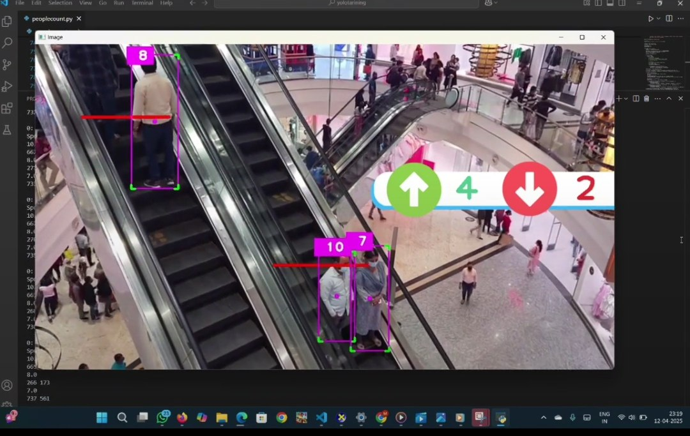

## 🚀 Real-Time People Counting on Escalators using YOLOv8-Nano

This project presents a **real-time people counting system specifically designed for escalators**, leveraging the lightweight yet powerful **YOLOv8-Nano** object detection model. The solution is optimized to run smoothly on **resource-limited systems and edge devices**, ensuring accurate and lag-free performance in real-world environments.

The system detects people from a video feed, tracks their movement across a defined counting line on the escalator, and counts them based on their **direction of movement (upward or downward)**.

---

### 📸 Project Demonstration

  

  <em>Real-time people counting on an escalator using YOLOv8-Nano.</em>

---

### 🔑 Key Features

- Real-time people detection using **YOLOv8-Nano**
- Accurate counting based on movement direction
- Works efficiently on **edge devices and low-end hardware**
- Minimal latency with high detection accuracy
- Seamless video processing using **OpenCV**

---

### 🧠 How It Works

1. Video frames are captured using OpenCV
2. YOLOv8-Nano detects people in each frame
3. Bounding box centroids are tracked across frames
4. A virtual counting line determines direction of movement
5. People are counted as they cross the line

---

### 🎯 Real-World Applications

- Crowd monitoring in malls, metros, and airports
- Public safety and congestion control
- Smart infrastructure and escalator analytics
- Data-driven decision making for urban planning

---

### 🛠 Tech Stack

- **YOLOv8-Nano**
- **Python**
- **OpenCV**
- **Computer Vision**

---

### 📈 What I Learned

- Building optimized real-time computer vision pipelines
- Deploying AI models for practical, real-world use cases
- Understanding object detection, tracking, and counting logic
- Gained confidence to move toward **training custom AI models**

---

### 📌 Future Improvements

- Multi-camera support
- Improved tracking with DeepSORT
- Dashboard visualization for analytics
- Model fine-tuning for crowded environments

---

**Author:** Pilla Vennela
**License:** MIT
